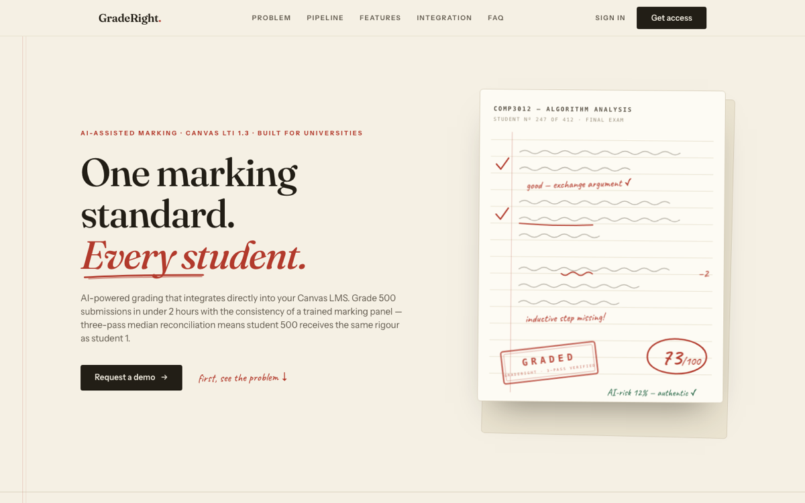
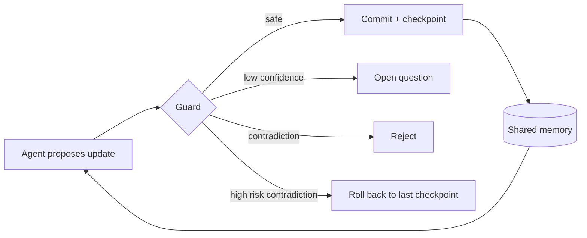
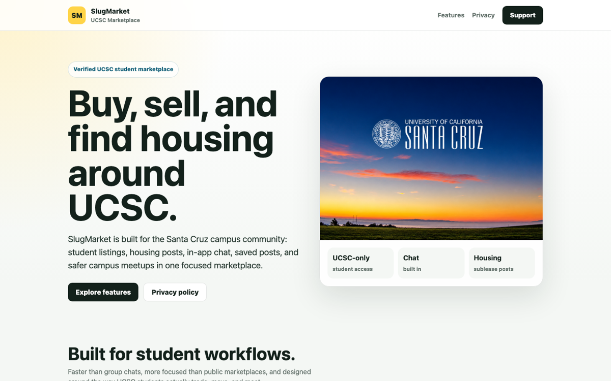
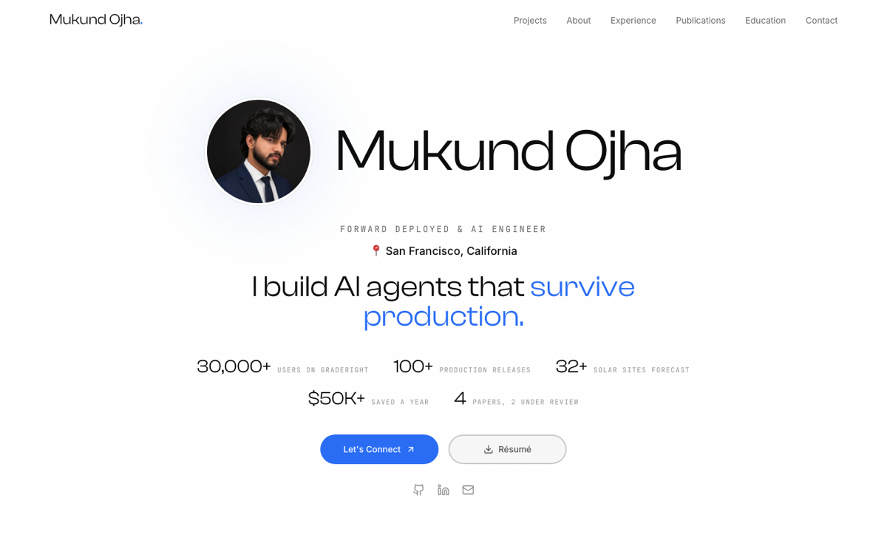

<h1 align="center">Mukund Ojha</h1>

<b>I build AI systems that run in production, and I measure whether they work.</b>

Lead App Engineer at TopTutors · Founder of <a href="https://graderight.org">GradeRight.org</a> · MS CS at UC Santa Cruz, graduating December 2026

<table align="center">
<tr>
<td align="center"><h3>30,000+</h3>users on GradeRight</td>
<td align="center"><h3>100+</h3>production releases</td>
<td align="center"><h3>4</h3>engineers led</td>
<td align="center"><h3>$50K+</h3>saved a year at Avaada</td>
<td align="center"><h3>2</h3>papers under review</td>
</tr>
</table>

---

## GradeRight.org: AI grading at 30,000+ users

I founded GradeRight and built it alone. It's an AI grading product that plugs into Canvas, earns revenue, and has more than 30,000 users.

* **Consistent grades.** Every submission gets three parallel grading passes reconciled by a median, so student 500 is graded the same way as student 1.
* **Model routing.** Light tasks go to a small model, and heavy grading goes to open source models I self host on vLLM.
* **Nothing ships untested.** Every prompt or model change has to pass a golden set evaluation first, which keeps human overrides under 10%.
* **Safe inputs.** Every student submission is screened for prompt injection before it reaches a grading model.

## TopTutors: Lead App Engineer

I lead 4 engineers on a multitenant B2B school platform (Next.js, React, PostgreSQL, AWS) and own production deploys across 100+ releases with zero downtime.

* Built the AI assessment pipeline that turns exam PDFs into graded tests, cutting exam setup from hours to minutes.
* Built an async job system with parallel workers, retries, and a serialized write queue that prevents races.
* Built a tutor matching engine that scores every tutor and student pair on 8 weighted dimensions.
* Set up an MCP server that maps our 9,000+ symbol codebase, so coding agents check what each edit touches before they change it.

---

## Research

### Commit Before Trust: Transactional Shared Memory for Multi-Agent LLMs *(under review)*

When agents share memory, one wrong update can quietly spread through the whole workflow. We treat shared memory like a database: agents propose, a guard decides, and checkpoints undo mistakes.

| Result on HotpotQA vs full history passing | |
| :--- | :--- |
| Tokens, full guarded system under fault injection | **62% fewer** (6,573 to 2,520) |
| Exact match, same setting | **0.50 to 0.54** |
| Injected contradictions caught by the guard | **50 of 50** on HotpotQA, **50 of 50** on FEVER |

### [Diagnosing How Frontier LLMs Fail at Lean: A miniF2F-v2 Evaluation Study](https://github.com/Mukund604/CSE290_LLM_Evaluation_Using_Lean) *(under review)*

I built a harness that checks every model proof with the Lean 4 compiler, then ran 222 runs across 30 problems, 8 difficulty strata and 3 seeds. A common 180 second timeout understated pass rates **3x**, and every failure was sorted into a taxonomy.

---

## Shipped and shipping

<table>
<tr>
<td width="50%" valign="top">

<b><a href="https://apps.apple.com/us/app/slugmarket/id6767780635">SlugMarket</a></b>, live on the App Store 
A UCSC only marketplace for listings, housing and chat. Swift, Supabase, row level security, real time messaging and push notifications.
</td>
<td width="50%" valign="top">

<b><a href="https://mukundojha.dev">mukundojha.dev</a></b> 
Everything in one place: projects, experience, publications and resume.
</td>
</tr>
</table>

* **VagBay**, launching soon: a marketplace and community app for Volkswagen Group enthusiasts. React Native, NestJS, PostgreSQL full text search, Redis backed rate limits.
* **Avaada Energy** (2023 to 2025): first AI/ML hire. Java and Python services ran ML models across 32+ solar sites and saved $50K+ a year, and fleet alerting raised uptime 18%.

---

## Toolkit

| | |
| :--- | :--- |
| **Languages** | Python, TypeScript, Java, SQL, Swift |
| **AI** | LLM APIs, LangGraph, vLLM, RAG, MCP, PyTorch |
| **Backend and infra** | FastAPI, NestJS, Next.js, PostgreSQL, Redis, Docker, Kubernetes, AWS |

## Education

* **M.S. in Computer Science and Engineering**, UC Santa Cruz, GPA 3.92/4.00, graduating December 2026
* **B.Tech in Computer Science Engineering**, Chitkara University, GPA 4.0/4.0
