<h1 align="center">Mukund Ojha</h1>

<b>I build AI systems that run in production, and I measure whether they work.</b>

Founding Engineer at TopTutors · Founder of <a href="https://graderight.org">GradeRight.org</a> · MS CS at UC Santa Cruz, graduating December 2026

<i>Open to full time AI engineering and software engineering roles.</i>

<table align="center">
<tr>
<td align="center"><h3>30,000+</h3>users on GradeRight</td>
<td align="center"><h3>200+</h3>schools on TopTutors</td>
<td align="center"><h3>150+</h3>production releases</td>
<td align="center"><h3>$50K+</h3>saved a year at Avaada</td>
<td align="center"><h3>4</h3>papers under review</td>
</tr>
</table>

---

## GradeRight.org: AI grading for 30,000+ users

<a href="https://github.com/Mukund604/Mukund604/blob/main/assets/graderight-intro.mp4">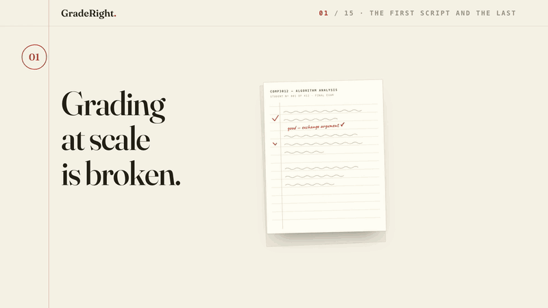</a>

<b><a href="https://github.com/Mukund604/Mukund604/blob/main/assets/graderight-intro.mp4">▶ Watch the full intro film (1:13, with sound)</a></b>

I founded GradeRight and built it alone. It's an AI grading product that plugs into Canvas, earns revenue, and has more than 30,000 users.

* **Consistent grades.** Every submission gets three parallel grading passes reconciled by a median, so student 500 is graded the same way as student 1.
* **Model routing.** Light tasks go to a small model, and heavy grading goes to open source models I self host on vLLM.
* **Every change is tested first.** A prompt or model change has to pass a golden set evaluation, which keeps human overrides under 10%.
* **Safe inputs.** Every student submission is screened for prompt injection before it reaches a grading model.

## TopTutors: Founding Engineer

I lead 4 engineers on a multitenant B2B school platform used across 200+ schools. I built it from 0 to 1 in Next.js, React, PostgreSQL and AWS, own all of its AI, and have run 150+ production releases with zero downtime.

* **Exam pipeline.** Turns exam PDFs into graded tests, cutting setup from hours to minutes, and blocks publishing when questions and answer keys disagree.
* **AI hiring pipeline.** Scores tutor interview transcripts against a versioned rubric, and admins can correct any score with a reason. Interviews were the company's biggest bottleneck.
* **Course assistant.** A RAG chatbot grounded in each school's own material and scoped to its students.
* **Content moderation.** Rules first, then LLM judgment, and anything uncertain fails closed to human review.
* **Matching engine.** Scores every tutor and student pair on 8 weighted dimensions.
* **Job system.** Async workers with retries and a serialized write queue that prevents races.

---

## Research

All 4 papers are under review.

### [Commit Before Trust: Transactional Shared Memory for Multi-Agent LLMs](https://mukundojha.dev/papers/commit-before-trust.pdf)
*Mukund Ojha, Sakshi Konnur, Saranya Kolachana · UC Santa Cruz, 2026* · [PDF](https://mukundojha.dev/papers/commit-before-trust.pdf) · [LinkedIn write-up](https://www.linkedin.com/posts/mukund604_structured-shared-memory-and-checkpointed-ugcPost-7469642360646385665-17KC/)

When agents share memory, one wrong update can quietly spread through the whole workflow. We treat shared memory like a database: agents propose, a guard decides, and checkpoints undo mistakes.

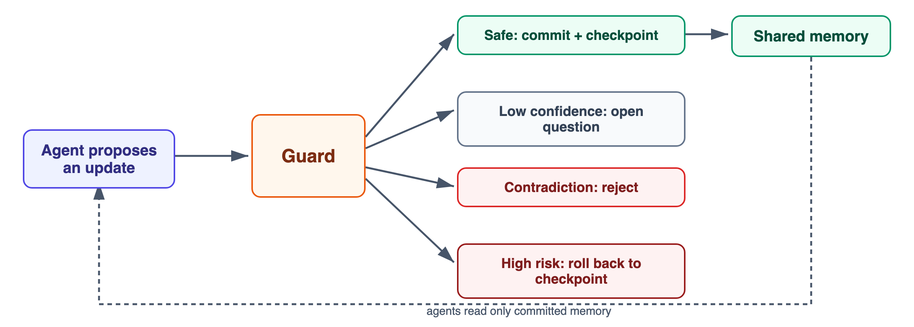

<table align="center">
<tr><th colspan="2">Result on HotpotQA vs full history passing</th></tr>
<tr><td>Tokens, full guarded system under fault injection</td><td><b>62% fewer</b> (6,573 to 2,520)</td></tr>
<tr><td>Exact match, same setting</td><td><b>0.50 to 0.54</b></td></tr>
<tr><td>Injected contradictions caught by the guard</td><td><b>50 of 50</b> on HotpotQA, <b>50 of 50</b> on FEVER</td></tr>
</table>

### [Diagnosing How Frontier LLMs Fail at Lean: A miniF2F-v2 Evaluation Study](https://mukundojha.dev/papers/frontier-llms-fail-at-lean.pdf)
*Mukund Ojha · UC Santa Cruz, 2026* · [PDF](https://mukundojha.dev/papers/frontier-llms-fail-at-lean.pdf) · [Code and results](https://github.com/Mukund604/CSE290_LLM_Evaluation_Using_Lean) · [LinkedIn write-up](https://www.linkedin.com/posts/mukund604_how-frontier-llms-fail-at-lean-ugcPost-7471693068656746496-hQH8/)

I built a harness that checks every model proof with the Lean 4 compiler, then ran 222 runs across 30 problems, 8 difficulty strata and 3 seeds. A common 180 second timeout understated pass rates **3x**, and every failure was sorted into a taxonomy.

<a href="https://github.com/Mukund604/CSE290_LLM_Evaluation_Using_Lean">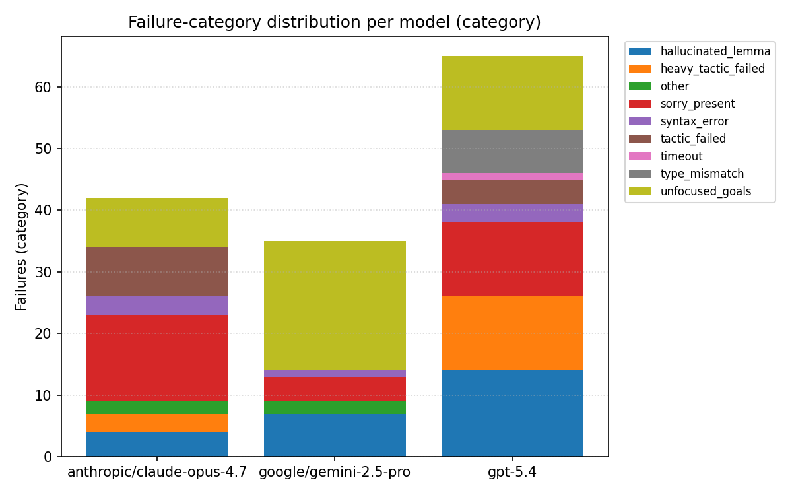</a>

### [Two Stage Residual Models for Robust Cloud Ramp Prediction](https://mukundojha.dev/papers/two-stage-residual-cloud-ramp.pdf)
*Mukund Ojha · UC Santa Cruz, 2025* · [PDF](https://mukundojha.dev/papers/two-stage-residual-cloud-ramp.pdf)

Forecasts sudden drops in solar output when clouds pass over utility scale plants. A baseline regressor makes the first forecast, and a temporal convolutional network with XGBoost learns to correct its errors.

<b>See the figures</b>

 

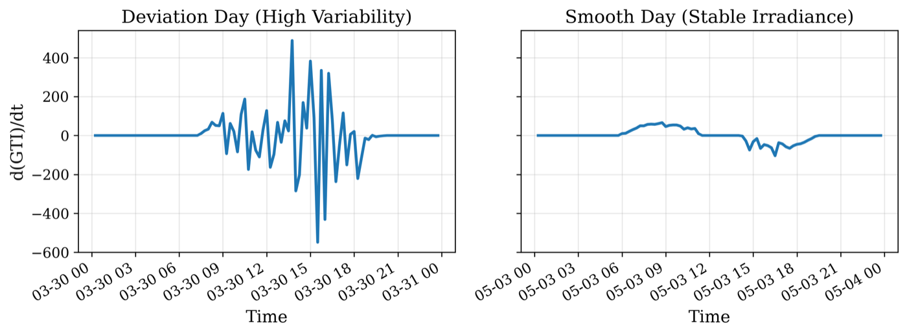
 The problem: irradiance swings on a cloudy day (left) versus a clear day (right)

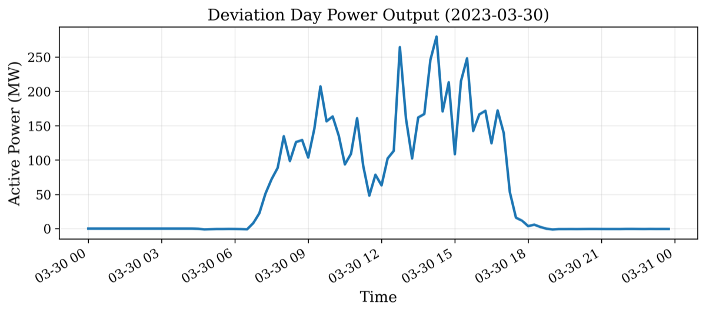
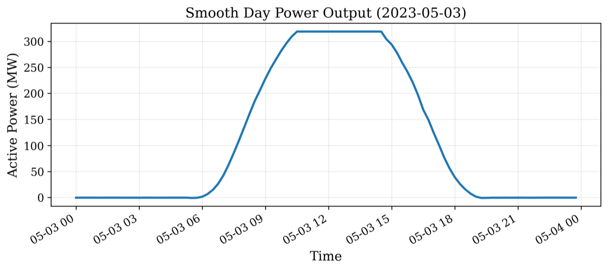
 Output swings by more than 150 MW in under an hour on a cloudy day (left), compared with a smooth curve on a clear day (right)

### RAG Robots: Retrieval-Augmented Generation for Enhanced Robotic Task Planning
*Jonathan Morris, Mukund Ojha, Izat Temiraliev, Yi Zhang, 2026*

Gives robot agents retrieval over a hybrid graph and vector database, so a planner agent trained with PPO acts on retrieved, task specific knowledge instead of what the language model guesses. Evaluated on furniture assembly tasks, where retrieval cut hallucination driven errors.

<b>See the simulation</b>

 

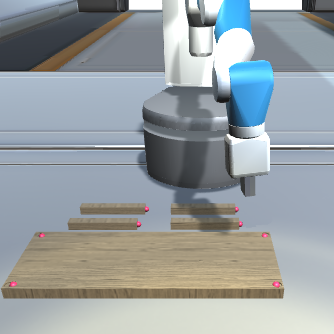
 Simulated furniture assembly task used for evaluation

---

## Apps

### SlugMarket, live on the App Store
<a href="https://apps.apple.com/us/app/slugmarket/id6767780635">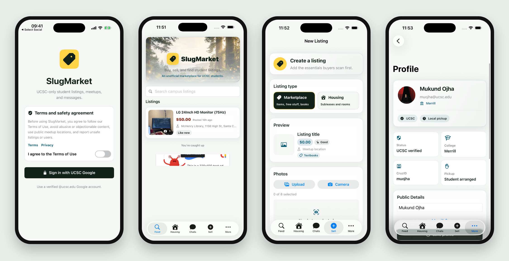</a>

A UCSC only marketplace for listings, housing and chat. Sign in is limited to verified ucsc.edu Google accounts, data is locked down with Postgres row level security, and buyers and sellers get real time chat with push notifications. There's also a web version in Next.js. **Swift, SwiftUI, Supabase, PostgreSQL, APNs.**

### VagBay, launching soon
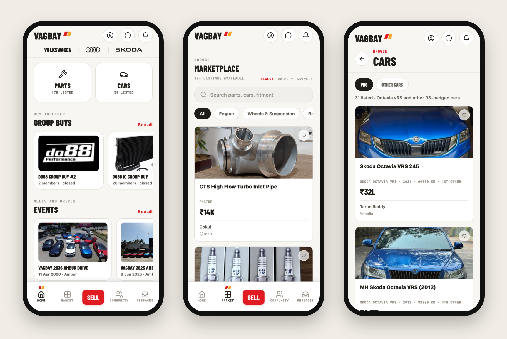

A marketplace and community app for Volkswagen, Audi and Skoda enthusiasts in India: parts and cars, group buys, events and messaging. The API has rotating refresh tokens, Postgres full text search with a radius filter, Redis backed rate limits across replicas, and a dealer verification queue in a Next.js admin dashboard. **React Native, Expo, TypeScript, NestJS, PostgreSQL, Redis, Docker.**

### The Select Social, launching in a few months
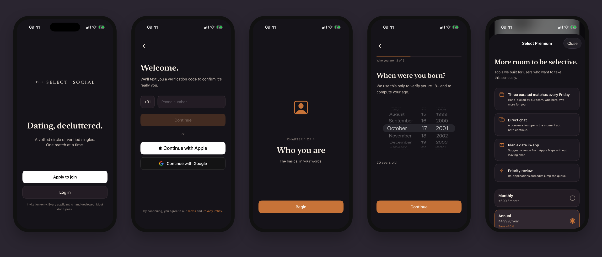
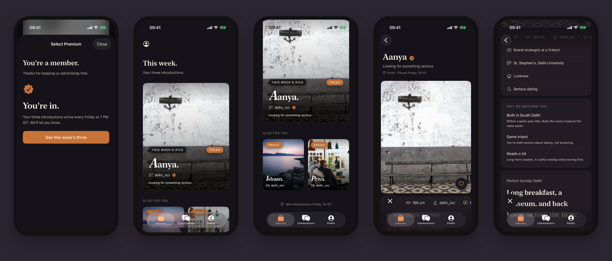

An invite only dating app for urban India, built around three curated introductions every Friday instead of a swipe feed. Applicants go through onboarding and live selfie verification before a hand review. Members get a "why we matched you" breakdown from an explainable matching engine that runs as a weekly batch. I wrote 225 backend tests covering auth, matching and moderation, run in CI on every change, plus 300+ iOS unit tests. **Python, FastAPI, PostgreSQL, Swift, SwiftUI.**

---

## AI agents

* **CaseLumen.** A multi hop RAG agent over a 5,000+ document legal corpus that cut research time 40% and raised recall 22%. I deployed it end to end, from OCR of scanned PDFs to retrieval, with self hosted Qdrant. **Python, LangChain, Qdrant, Docker.**
* **[NyayNet](https://github.com/Mukund604/NyayNet).** Detects abusive and threatening Instagram comments with multilingual NLP and files structured complaints to India's cybercrime portal.

## Sites

<table>
<tr>
<td width="50%" valign="top">
<a href="https://mukundojha.dev">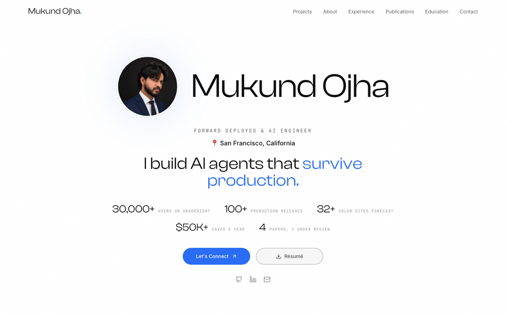</a>
<b><a href="https://mukundojha.dev">mukundojha.dev</a></b> 
Projects, experience, papers and resume in one place.
</td>
<td width="50%" valign="top">

<b><a href="https://mukund604.github.io/SJStanceCustoms-Preview/">SJ Stance Custom Wheels</a></b> 
A storefront for a custom wheel shop, with a wheel visualizer and a quote flow.
</td>
</tr>
</table>

---

## Experience

* **Founding Engineer, TopTutors** (May 2026 to present)
* **Founder, GradeRight.org** (September 2025 to present)
* **Assistant Manager, Machine Learning Engineer, Avaada Energy** (September 2023 to September 2025). First dedicated AI/ML hire, and led the AI and ML team. Java and Python services ran ML models across 32+ solar sites and saved $50K+ a year, and predictive maintenance alerts across 500+ units raised uptime 18%.

## Toolkit

| | |
| :--- | :--- |
| **Languages** | Python, TypeScript, Java, SQL, Swift |
| **AI** | LLM APIs, LangChain, LangGraph, vLLM, RAG, MCP, Qdrant, FAISS, PyTorch |
| **Backend** | FastAPI, NestJS, Next.js, React, Prisma, PostgreSQL, Redis |
| **Infrastructure** | AWS, Docker, Kubernetes, CI/CD |

## Education

* **M.S. in Computer Science and Engineering**, UC Santa Cruz, GPA 3.92/4.00, graduating December 2026
* **B.Tech in Computer Science Engineering**, Chitkara University, GPA 4.0/4.0
