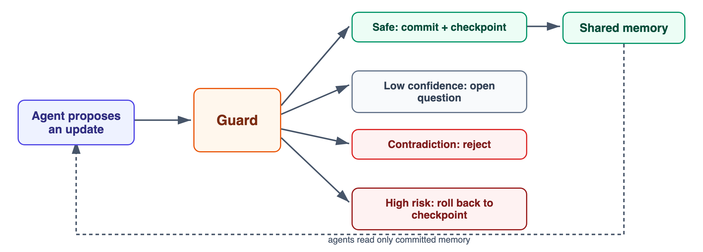
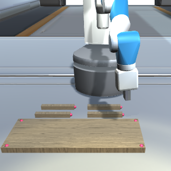
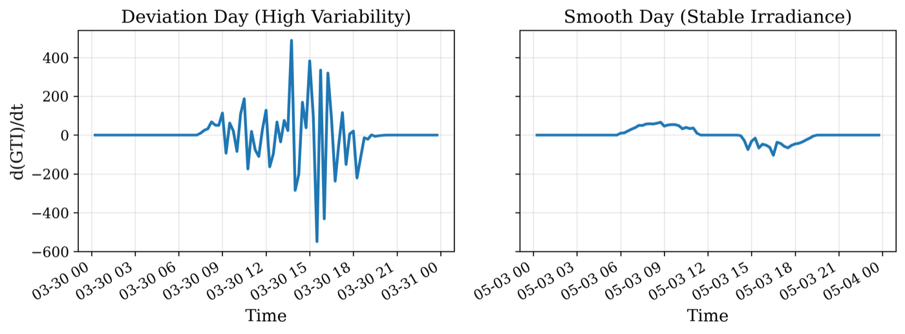
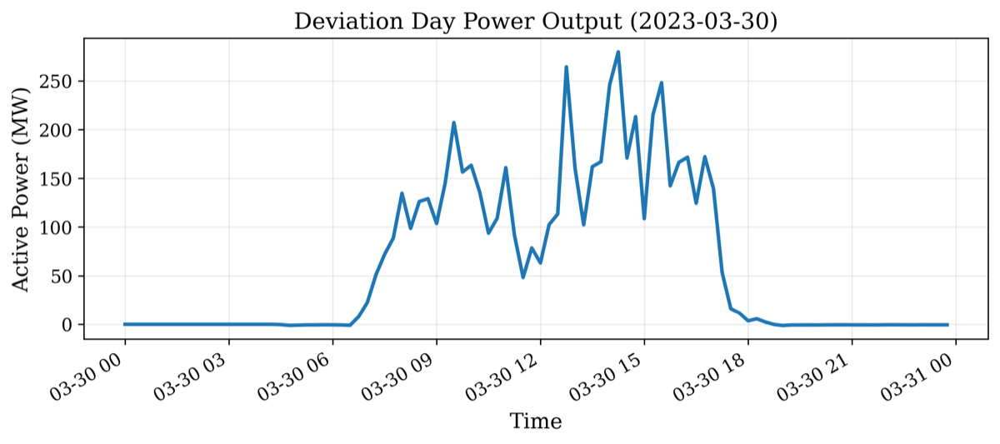
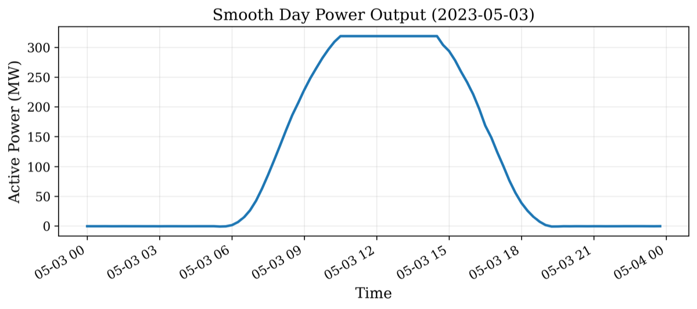
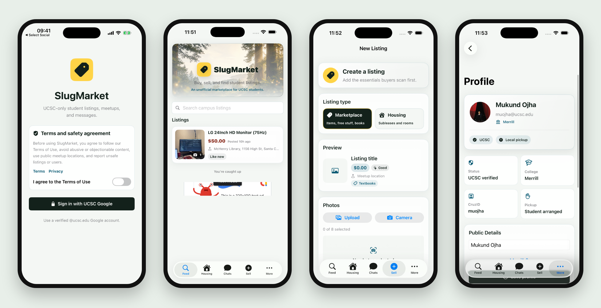
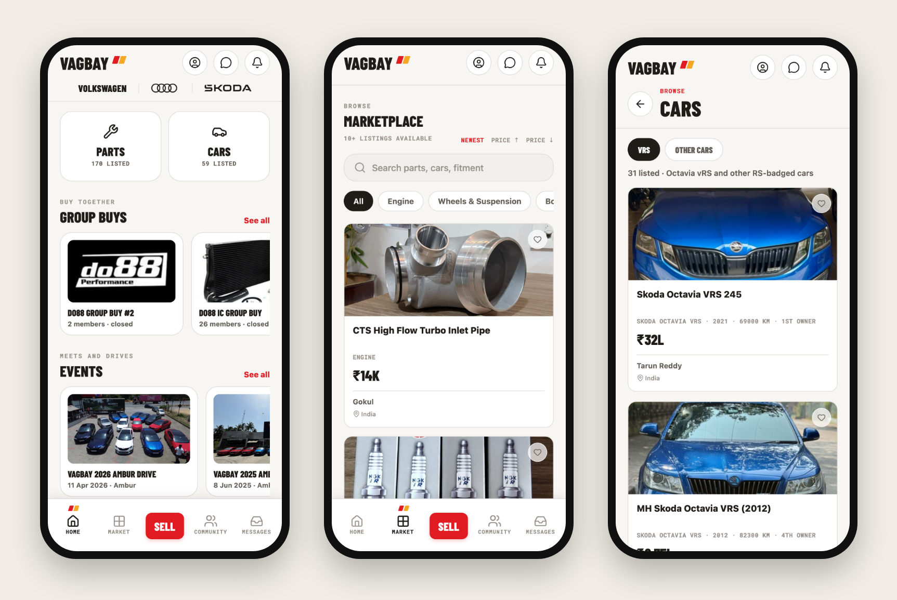
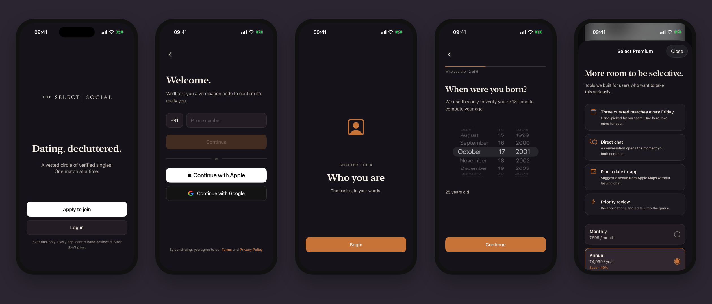
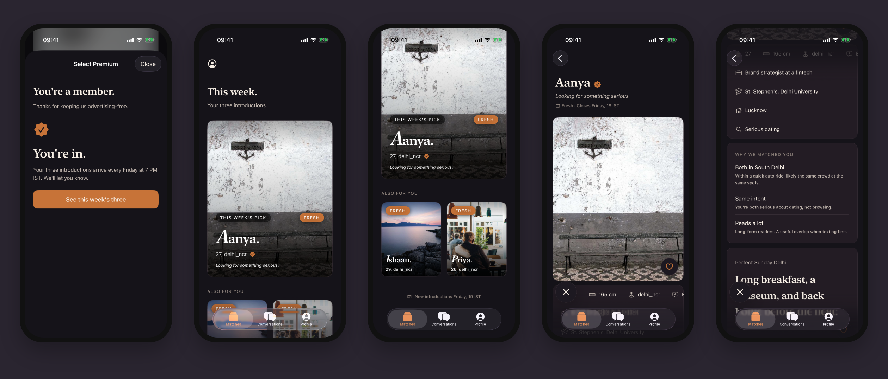
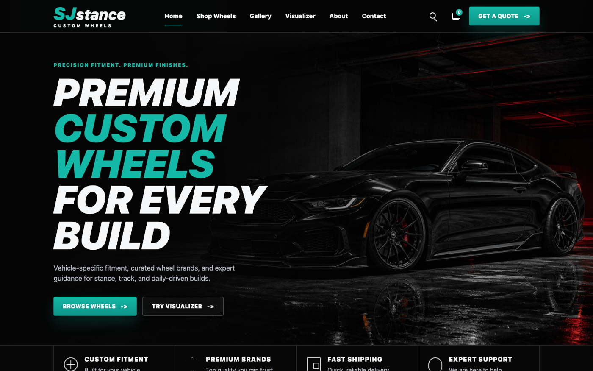

<h1 align="center">Mukund Ojha</h1>

<b>I build AI systems that run in production, and I measure whether they work.</b>

Lead App Engineer at TopTutors · Founder of <a href="https://graderight.org">GradeRight.org</a> · MS CS at UC Santa Cruz, graduating December 2026

<i>Open to full time software engineering and AI engineering roles starting January 2027.</i>

<table align="center">
<tr>
<td align="center"><h3>30,000+</h3>users on GradeRight</td>
<td align="center"><h3>100+</h3>production releases</td>
<td align="center"><h3>4</h3>engineers led</td>
<td align="center"><h3>$50K+</h3>saved a year at Avaada</td>
<td align="center"><h3>4</h3>papers, 2 under review</td>
</tr>
</table>

---

## GradeRight.org: AI grading at 30,000+ users

I founded GradeRight and built it alone. It's an AI grading product that plugs into Canvas, earns revenue, and has more than 30,000 users.

* **Consistent grades.** Every submission gets three parallel grading passes reconciled by a median, so student 500 is graded the same way as student 1.
* **Model routing.** Light tasks go to a small model, and heavy grading goes to open source models I self host on vLLM.
* **Nothing ships untested.** Every prompt or model change has to pass a golden set evaluation first, which keeps human overrides under 10%.
* **Safe inputs.** Every student submission is screened for prompt injection before it reaches a grading model.

## TopTutors: Lead App Engineer

I lead 4 engineers on a multitenant B2B school platform (Next.js, React, PostgreSQL, AWS) and own production deploys across 100+ releases with zero downtime.

* Built the AI assessment pipeline that turns exam PDFs into graded tests, cutting exam setup from hours to minutes.
* Built an async job system with parallel workers, retries, and a serialized write queue that prevents races.
* Built a tutor matching engine that scores every tutor and student pair on 8 weighted dimensions.
* Set up an MCP server that maps our 9,000+ symbol codebase, so coding agents check what each edit touches before they change it.

---

## Publications

4 papers: 2 under review in 2026 and 2 preprints.

### 1. Commit Before Trust: Transactional Shared Memory for Multi-Agent LLMs *(under review, 2026)*
*Mukund Ojha, Sakshi Konnur, Saranya Kolachana · UC Santa Cruz* · [Read the LinkedIn write-up](https://www.linkedin.com/posts/mukund604_structured-shared-memory-and-checkpointed-ugcPost-7469642360646385665-17KC/) · [Paper on mukundojha.dev](https://mukundojha.dev/#publications)

When agents share memory, one wrong update can quietly spread through the whole workflow. We treat shared memory like a database: agents propose, a guard decides, and checkpoints undo mistakes.

| Result on HotpotQA vs full history passing | |
| :--- | :--- |
| Tokens, full guarded system under fault injection | **62% fewer** (6,573 to 2,520) |
| Exact match, same setting | **0.50 to 0.54** |
| Injected contradictions caught by the guard | **50 of 50** on HotpotQA, **50 of 50** on FEVER |

### 2. [Diagnosing How Frontier LLMs Fail at Lean: A miniF2F-v2 Evaluation Study](https://github.com/Mukund604/CSE290_LLM_Evaluation_Using_Lean) *(under review, 2026)*
*Mukund Ojha · UC Santa Cruz · [code and results](https://github.com/Mukund604/CSE290_LLM_Evaluation_Using_Lean) · [LinkedIn write-up](https://www.linkedin.com/posts/mukund604_how-frontier-llms-fail-at-lean-ugcPost-7471693068656746496-hQH8/)*

I built a harness that checks every model proof with the Lean 4 compiler, then ran 222 runs across 30 problems, 8 difficulty strata and 3 seeds. A common 180 second timeout understated pass rates **3x**, and every failure was sorted into a taxonomy.

### 3. RAG Robots: Retrieval-Augmented Generation for Enhanced Robotic Task Planning *(preprint, 2026)*
Gives robot agents retrieval over a hybrid graph and vector database, so a planner agent trained with PPO acts on retrieved, task specific knowledge instead of what the language model guesses. Evaluated on furniture assembly tasks, where retrieval cut hallucination driven errors.

 Simulated furniture assembly task used for evaluation

### 4. Two Stage Residual Models for Robust Cloud Ramp Prediction *(preprint, 2025)*
Forecasts sudden drops in solar output when clouds pass over utility scale plants. A baseline regressor makes the first forecast, and a temporal convolutional network with XGBoost learns to correct its errors.

 The problem: irradiance swings on a cloudy day (left) versus a clear day (right)

 What it does to a utility scale plant: output swings by more than 150 MW in under an hour on a cloudy day (left), compared with a smooth curve on a clear day (right)

---

## Apps I've built

### SlugMarket, live on the App Store

A UCSC only marketplace for listings, housing and chat. Sign in is limited to verified ucsc.edu Google accounts, data is locked down with Postgres row level security, and buyers and sellers get real time chat with push notifications. **Swift, SwiftUI, Supabase, PostgreSQL, APNs.** There's also a web version in Next.js.

### VagBay, launching soon

A marketplace and community app for Volkswagen, Audi and Skoda enthusiasts in India: parts and cars, group buys, events and messaging. The API has rotating refresh tokens, Postgres full text search with a radius filter, Redis backed rate limits across replicas, and a dealer verification queue in a Next.js admin dashboard. **React Native, Expo, TypeScript, NestJS, PostgreSQL, Redis, Docker.**

### The Select Social, in development

An invite only dating app for urban India, built around three curated introductions every Friday instead of a swipe feed. Applicants sign in by phone, email, Apple or Google, then go through a 19 step onboarding flow and live camera selfie verification before a hand review. Members get a weekly hero match plus two more, a "why we matched you" breakdown, chat with in-app date planning, and a subscription paywall. 317 unit tests cover every service and view model. **Swift, SwiftUI, Swift Concurrency, XCTest.**

### Client and personal sites
<table>
<tr>
<td width="50%" valign="top">

<b><a href="https://mukund604.github.io/SJStanceCustoms-Preview/">SJ Stance Custom Wheels</a></b> 
A storefront for a custom wheel shop, with a wheel visualizer and a quote flow.
</td>
<td width="50%" valign="top">

<b><a href="https://mukundojha.dev">mukundojha.dev</a></b> 
Projects, experience, publications and resume in one place.
</td>
</tr>
</table>

### Earlier work
* **Avaada Energy** (2023 to 2025): first AI/ML hire. Java and Python services ran ML models across 32+ solar sites and saved $50K+ a year, and fleet alerting raised uptime 18%.
* **[NyayNet](https://github.com/Mukund604/NyayNet)**: an agent that detects abusive and threatening Instagram comments with multilingual NLP and files structured complaints to India's cybercrime portal.

---

## Toolkit

| | |
| :--- | :--- |
| **Languages** | Python, TypeScript, Java, SQL, Swift |
| **AI** | LLM APIs, LangGraph, vLLM, RAG, MCP, PyTorch |
| **Backend and infra** | FastAPI, NestJS, Next.js, PostgreSQL, Redis, Docker, Kubernetes, AWS |

## Education

* **M.S. in Computer Science and Engineering**, UC Santa Cruz, GPA 3.92/4.00, graduating December 2026
* **B.Tech in Computer Science Engineering**, Chitkara University, GPA 4.0/4.0
